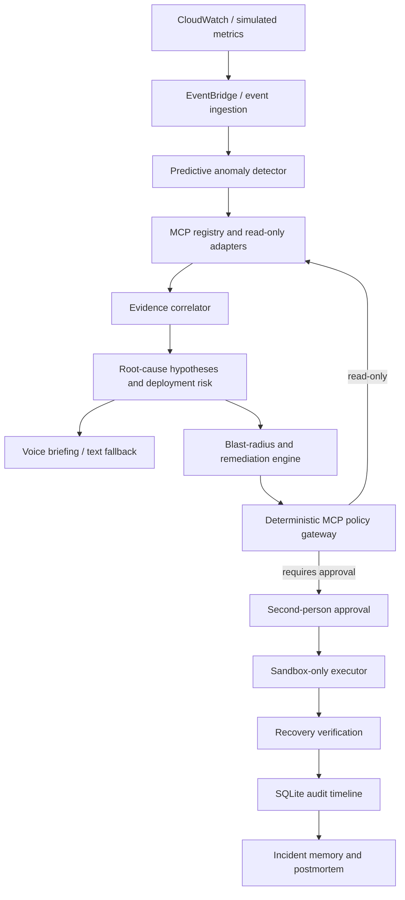

# PAGER — Predictive, Voice-First AI Incident Commander
**RIT Hackathon prototype | Detect early · Investigate intelligently · Resolve safely**

PAGER is an incident-response assistant for on-call engineering teams. It correlates monitoring signals, deployment metadata, logs and runbooks; surfaces evidence-backed root-cause hypotheses; maps potential service blast radius; briefs the operator by voice; and routes remediation through a deterministic MCP-style policy gateway.

> **Demo honesty:** This repository runs in local simulation mode. The shopping-platform metrics, deployment, logs, runbook, historical incident and service graph are seeded fixtures. The rollback changes only the demo's simulated state. No production system, real CloudWatch account, Slack workspace, GitHub repository, Bedrock model, ElevenLabs agent or external MCP server is connected by default.

## 1. Requirements
- Python 3.10+
- Node.js 20+ and npm
- Windows PowerShell, macOS or Linux

## 2. Run on Windows PowerShell
Open two terminals in the repository root.

**Terminal A — API**
```powershell
cd backend
py -3 -m venv .venv
.\.venv\Scripts\Activate.ps1
pip install -r requirements.txt
uvicorn app.main:app --reload --port 8000
```
If PowerShell blocks activation, run `Set-ExecutionPolicy -Scope Process -ExecutionPolicy Bypass` in that terminal, then activate again.

**Terminal B — UI**
```powershell
cd frontend
npm install
npm run dev
```
Open http://localhost:5173. API docs: http://localhost:8000/docs.

## 3. macOS / Linux
**Terminal A**
```bash
cd backend
python3 -m venv .venv
source .venv/bin/activate
pip install -r requirements.txt
uvicorn app.main:app --reload --port 8000
```
**Terminal B**
```bash
cd frontend
npm install
npm run dev
```

## 4. Three-minute judge demo
The demo leads with the MCP policy gateway. See [docs/demo-script.md](docs/demo-script.md) for timings.
1. Start at the healthy baseline. Point at the **Agent loop** strip and the **Policy tiers** panel: every step from Investigate onward is checked by the gateway.
2. Click **Trigger incident**. In the **Gateway feed**, the agent first runs MCP discovery (`tools/list` on 4 servers), then makes 5 read-only MCP tool calls. Each one is checked by the gateway first, then marked SENT VIA MCP.
3. Click **Try drop_database** and **Try purge_logs**. Both are denied and never sent. `purge_logs` is a real tool on a real MCP server that labels itself read-only, but it is not in the trusted registry.
4. Open **Investigation**. Each piece of evidence names the MCP tool and server it came from.
5. Open **Approvals** and dry-run each action. Each shows the gateway's verdict: read-only → ALLOW, scaling → NEEDS CONFIRM, rollback → NEEDS APPROVAL.
6. Open **Service map**. The fault path runs up from Orders DB; the dry run's blast radius is outlined.
7. Request approval, approve as `teammate.approver`, then **Execute sandbox rollback**. The gateway re-checks the approval; the agent verifies recovery with another MCP `get_metrics` call.
8. Back on **Overview**: all steps are done, metrics are back near baseline, and the service map is green. Play the **voice briefing**.
9. Optional: on **Policy & security**, show the connected MCP servers, then turn on the kill switch and show that the rollback is blocked.

## 5. API surface
- `POST /api/incidents/trigger`
- `GET /api/incidents`, `GET /api/incidents/{id}`
- `GET /api/metrics`
- `GET /api/incidents/{id}/evidence`
- `GET /api/incidents/{id}/predictions`
- `GET /api/incidents/{id}/blast-radius`
- `POST /api/incidents/{id}/recommendations`
- `POST /api/actions/{id}/preview`
- `POST /api/actions/request-approval`
- `POST /api/approvals/{id}/decision`
- `POST /api/actions/{id}/execute`
- `GET /api/incidents/{id}/timeline`
- `GET /api/audit`
- `GET /api/postmortem`
- `POST /api/policy/kill-switch`
- `POST /api/demo/reset`
- `GET /api/voice/briefing`
- `GET /api/memory`, `GET /api/policy`, `GET /api/status`
- `GET /api/gateway/log` (gateway feed), `POST /api/gateway/probe` (send an unsafe call on purpose)
- `GET /api/mcp/servers` (MCP discovery compared with the trusted registry), `GET /api/blast-radius`

Interactive OpenAPI docs are at `/docs`.

## 5a. MCP in this build
| Part | Status |
|---|---|
| `pager-monitoring`, `pager-deployments`, `pager-runbooks`, `pager-memory` | **Real MCP servers** built with the official MCP Python SDK (FastMCP), in [backend/app/mcp/servers.py](backend/app/mcp/servers.py). The data behind them is seeded. |
| MCP client | **Real.** [backend/app/mcp/client.py](backend/app/mcp/client.py) opens MCP sessions (`initialize`, `tools/list`, `tools/call` over JSON-RPC), in memory inside the API process. |
| Policy gateway | **Real**, deterministic code. Runs *before* any request reaches a server; denied calls are never sent. |
| `pager-sandbox` write tools (rollback, scale) | **Mocked.** They change simulated state only and are not an MCP server in this build. |

Run a server on its own over stdio, for example to inspect it with the MCP Inspector:
```powershell
cd backend
.\.venv\Scripts\Activate.ps1
python -m app.mcp.servers pager-monitoring
```

## 6. Policy matrix
| Tier | Examples | Prototype behavior |
|---|---|---|
| Read-only | metrics, logs, deployments, runbooks | Allowed and audited |
| Non-production write | staging restart / test flag | Explicit confirmation; staging or sandbox only |
| Production write | rollback / config change | Second teammate approval; **execution is sandbox-only in this build** |
| Destructive | drop DB, delete critical data, disable safeguards | Denied outright |

The policy gateway uses a trusted local registry. MCP annotations are metadata, not authorization. Unknown server/tool identities default to deny. Requester cannot approve their own action. The model/voice layer cannot call an executor directly.

## 7. Architecture


## 8. Built vs planned integrations
**Built in this local prototype:** FastAPI API, React dashboard, SQLite audit events, seeded metrics/evidence/deploy/runbook/incident-memory fixtures, heuristic anomaly and deployment scoring, ranked root-cause hypotheses, dependency graph, recommendation cards, real MCP servers and client for the read-only tools (official MCP Python SDK), trusted registry and policy gateway in front of every tool call, kill switch, approval UI/API, sandbox rollback state transition, verification, browser speech synthesis, postmortem draft.

**Planned provider adapters (credentials and integration work required):**
- Amazon CloudWatch metrics/logs, EventBridge rules and Lambda event ingress
- Amazon Bedrock for evidence-grounded explanations; guardrails remain defense-in-depth
- ElevenLabs Agents / Twilio for phone voice calls
- Slack interactive approval and backup-engineer handoff
- GitHub deployments and commit diffs
- MCP servers over network transports (streamable HTTP) with auth, and a real MCP server for the write tools
- DynamoDB/S3 for managed persistence and incident artifacts

No credentials are required for the local demo. `.env.example` lists placeholders only.

## 9. Security and threat model
- Retrieved logs, tickets, commit messages and runbooks are untrusted data; they cannot alter local policy.
- Voice is not identity proof.
- Second-person approval is separate from the requester identity.
- Unknown servers/tools and ambiguous actions deny by default.
- Destructive actions are blocked.
- Kill switch disables agent-initiated writes.
- Sandbox-only action execution; no production credentials.
- For production: add authenticated SSO/RBAC, short-lived least-privilege cloud roles, signed approval actions, secrets manager, transcript retention/redaction, rate limits, idempotency keys, CSRF protection and immutable audit storage.

## 10. Tests
```bash
cd backend
pytest -q
```
Tests cover read-only allow, unknown tool deny, destructive deny, production-write approval requirement, self-approval denial, sandbox approval, staging boundary and end-to-end approval/execute/verify API flow. They also cover the gateway-checked investigation over MCP, per-action dry runs, safety probes, the kill switch, recovery, MCP discovery against the registry, and running a server standalone over stdio.

## 11. Known prototype limitations
- Metrics and integration evidence are deterministic fixtures, not live observability.
- Heuristic scores are illustrative and not calibrated outage probabilities.
- Dependency impact is inferred, not confirmed customer impact.
- The voice experience uses browser speech synthesis; no phone call is placed.
- Approval is a demo identity flow, not production authentication.
- The demo uses a simple seeded scenario and does not yet include a live alert stream or multi-tenant isolation.
