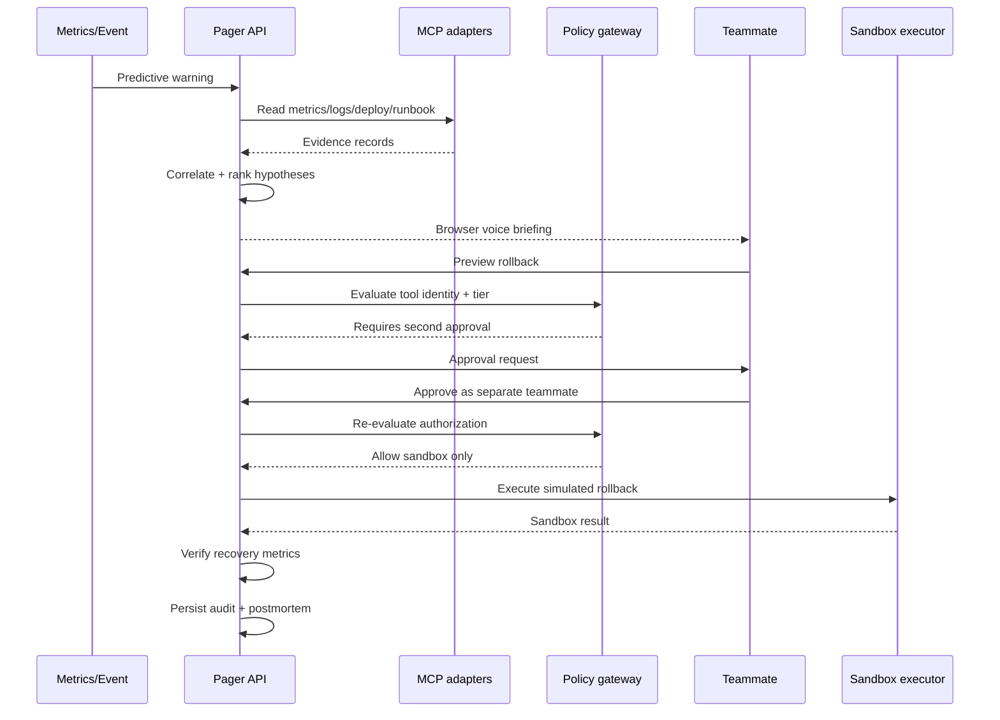

# Architecture & Sequence

PAGER uses an event-driven flow inspired by the project report: Monitoring → Event processing → MCP investigation → AI reasoning → Voice briefing → Policy gateway → Human approval → Execution → Verification → Audit, memory and postmortem.

The local prototype substitutes seeded monitoring/deployment/runbook adapters and a local MCP-compatible registry for live CloudWatch, EventBridge, GitHub and MCP services. The gateway is deterministic Python code outside any language model. The sandbox executor only updates simulated state.

